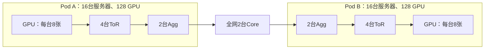

# Batch、千卡拓扑与 Scale-Out 研究范围

本文回答当前基准怎样设置 batch、千卡网络实际怎样连接、Scale-Up/Scale-Out 的差别，以及后续网络研究应改进什么。依据为当前源码、历史运行原始输入与已保存的运行成本证据；没有启动新的网络仿真，也没有实现下面提出的新机制。

## 1. Batch 是实验输入，不是模型常数

当前基准采用 `workload.batch_per_rank=1`，表示每张 GPU 每轮处理一个本地请求。当前是 KV 已准备好的 Decode：每个被选中的请求每轮生成一个 token。`context_tokens=2048` 是已有上下文长度，不表示每轮发送 2048 个 token；`decode_steps=2` 表示运行两轮。

对当前每卡等量请求的配置：

| 设置 | 每卡请求 | 每个 EP4 副本请求 | 1024 卡总请求 |
|---|---:|---:|---:|
| B=1 | 1 | 4 | 1024 |
| B=4 | 4 | 16 | 4096 |

128 卡 EP128 基准则分别是组内 128、512 个请求。不同 EP 配置不能只用一个没有作用范围的“batch=4”比较。

`scaleout_service.py::validate` 和规模脚本目前接受每卡 batch 为整数 1..16。不是所有模型、拓扑和 batch 组合都已经执行通过；显存检查覆盖声明权重与 KV，尚未覆盖真实 workspace、激活和分配器开销。

### 如何修改

可以复制 [模型配置](../../examples/scaleout_clos128/qwen3-128.json)，修改其 `workload.batch_per_rank`，保留其他字段，再通过现有 `scaleout rdma-run --config 新配置` 提交到新输出目录。不得只修改图或结果文件；需要重新构图和执行。

使用 [规模实验脚本](../../experiments/scaleout_scaling/run.py)时，已有公开参数：

```bash
# 在仓库根目录；Python、backend.json、protoc 使用已构建环境中的真实路径。
# 先生成和审计配置，不执行网络。
PYTHONPATH=python "$COSIM_PYTHON" experiments/scaleout_scaling/run.py \
  --backend-json "$COSIM_BACKEND" --protoc "$COSIM_PROTOC" \
  --output /dev/shm/scaleout-b4-prepare-new \
  --sizes 128 --batch-per-rank 4 --prepare-only
```

环境变量含义及后端构建见[复现说明](../../experiments/scaleout_scaling/README.md)。`--prepare-only` 仍需要有效的构建元数据及可读取的 probe/service 二进制，因为脚本要记录哈希。该脚本即使指定 `--sizes 128` 也生成 EP4 多副本，不能当成 EP128 基准；后者应使用 `examples/scaleout_clos128` 中的对应配置。

要生成千卡输入，将 `--sizes` 改为 `1024`；准备成功不等于千卡执行成功。实际仿真在预检通过后使用新的输出目录、去掉 `--prepare-only`。更大 batch 需要重新检查消息、内存、时间与磁盘预算，不自动提高限额。当前文档工作没有执行这些网络命令。

### 修改后什么会变

请求数量、KV 预留、声明计算工作量、专家贡献总数会变化。相同源/目的 GPU 的贡献会聚合，本卡贡献不发送，因此网络消息条数、非本卡字节与网络完成时间不保证严格成比例。当前改变 batch 也会改变合成路由的 token 集合及分配，不能解释成只改变一个固定消息的大小。

本次使用当前生成器对千卡配置的第一个 EP4 组、第一轮完整 48 层任务图做了离线检查：

| 每卡 batch | 专家贡献总数 | Dispatch+Combine 非本卡消息数 | 非本卡 payload 字节 | 每卡 KV 预留字节 |
|---|---:|---:|---:|---:|
| 1 | 1536 | 1036 | 9379840 | 202899456 |
| 4 | 6144 | 1152 | 37773312 | 811597824 |

这是一个组、一轮的图生成统计。非本卡消息包含同服务器不同 GPU 的机内传输，不等于全部经过外部 RDMA。这些数字不是新的网络性能结果。

## 2. 千卡实验实际采用的拓扑

当前规模脚本从百卡配置生成实际千卡输入；它并不直接使用 `examples/scaleout_topology/1024-clos.json`。已逐对象核对当前 `prepare(1024,1)` 的模型输入和物理拓扑，与历史 `baseline1024` 原始文件完全一致；原始 input/topology/probe 的 SHA-256 也与[保存证据](../../experiments/scaleout_scaling/results/runtime_20261016/evidence.json)一致。

| 对象 | 当前千卡设置 |
|---|---|
| GPU / server | 1024 GPU，128 台服务器，每台 8 GPU |
| Pod | 8 个网络分区，每个 16 台服务器、128 GPU |
| 交换机 | 每 Pod 4 ToR、2 Agg；全网 32 ToR、16 Agg、2 Core |
| rail / plane | 1 / 1 |
| 外部链路 | 1024 GPU 接入＋64 ToR–Agg＋16 Agg–Core＝1104 条 |
| 外部速率与传播 | 各层每条链路每方向 400 Gb/s，每边传播 1 μs |
| Core | 普通电分组交换机，无 OCS |
| 机内模型 | 每 GPU 每方向 450 GB/s，16 KiB 分块；进入和离开织构分别传播 100 ns |

机内模型是共享 GPU 入口/出口的无阻塞织构抽象，不是完整 NVLink/NVSwitch 或 PCIe 协议。400 Gb/s 约为 50 GB/s，不能与 450 GB/s 混用单位。

每个 Pod 中 ToR 连接本 Pod 的两个 Agg；Agg0 连 Core0，Agg1 连 Core1。跨 Pod 的路径为：

```text
源 GPU → 源 ToR → 源 Agg → Core → 目的 Agg → 目的 ToR → 目的 GPU
```



图只展开八个 Pod 中的两个；所有 Pod 连接同一对 Core，具体接线按上面的 Agg/Core 对应关系，不表示每个 Agg 连两个 Core。

这是一套明显超售的三层 Clos 参考输入：每 ToR 接入 32 GPU，下行合计 12.8 Tb/s，上联 0.8 Tb/s，局部下/上容量比 16:1；每 Agg 的 ToR 侧为 1.6 Tb/s、Core 侧为 0.4 Tb/s，比为 4:1。每 Pod 的 GPU 接入总量 51.2 Tb/s、跨 Pod 出口 0.8 Tb/s，比为 64:1。后一个是 Pod 接入/出口容量比，不能称作每个 Agg 的超售比或精确二分带宽。比例也不等于实测吞吐下降倍数。

### 业务怎样放进千卡网络

千卡输入有 256 个 EP4 推理副本；每个组有两对同服务器 GPU，分处两个 Pod。例如第一组为 `[0,1,512,513]`，前两张位于 Pod0/server0，后两张位于 Pod4/server64。各组不相互发送业务数据，但共享交换机和链路，能够互相争用资源。

当前 128 专家在 EP4 内每卡放 32 个专家；不是把一个模型的专家摊到千卡。当前组大小需整除专家数，不支持直接把这套 128 专家配置设成 EP1024。多个推理副本可以称为推理复制部署，但当前没有训练 DP 梯度 AllReduce。

千卡配置已生成、曾启动执行；两版均在 600 秒宿主限额处超时，没有最终模拟完成时间。256/512 卡已完成并独立核验；128 卡 EP128 也已完成。具体见[运行报告](../../experiments/scaleout_scaling/results/runtime_20261016/report.md)。

### 其他候选拓扑的状态

仓库还有 Leaf–Spine、较大三层 Clos、独立 Multi-rail 和 HPN 参考配置。本次重新生成并检查了这些配置的交换机计数和网络域；生成/审计不能当作完成业务性能对照。

特别是独立 8 rail 示例：每个 GPU 只接一个 rail，上层也隔离，458752 对无序 GPU 对没有直接分组网络路径。需要显式的机内中继/分层集合通信，或增加合适的 NIC 连接；当前不会把 GPU 自动当交换机。HPN 参考配置的共享上层具备跨 rail 路径，但没有复现生产 HPN 全部机制。

不同候选的交换机数量与执行限额也不同：静态 Clos 示例有 320 台交换机，超过当前原生执行器最多 256 台的支持边界；HPN 参考示例有 104 台，也超过当前规模协议的 64 台预算。不能仅替换拓扑文件就声称都能执行；需要明确处理端口、资源和运行边界。

## 3. Scale-Up 与 Scale-Out 的区别

两者可以服务同一个 MoE 请求；区别主要是数据经过哪一类互连，以及竞争哪些资源，不是是否使用 MoE 或 GPU 数量是否超过某个数。

| 维度 | Scale-Up | Scale-Out |
|---|---|---|
| 范围 | 一个紧耦合高速互连域，常见于机内或机柜内 | 跨服务器、跨网络分区 |
| 典型资源 | 芯片/设备端口、机内交换织构、信用与缓冲 | NIC、ToR/Agg/Core、上联、RDMA拥塞与流控 |
| 常见通信问题 | 端侧共享资源、出口竞争、流控和局部等待 | 多对一汇聚、跨Pod热点、路径负载不均、超售与拥塞传播 |
| 本仓库实现 | 原有 ns-3-UB 路线，CM384 示例中 rank 可对应 die | 新增独立的非 UB 原生 RDMA ns-3 路线，rank 对应 GPU |

UB 是原路线的具体互连模型，不是所有 Scale-Up 的统称。当前 Scale-Out 执行器也包含简化机内模型：同服务器传输走机内抽象，跨服务器走 RDMA，两者共享一个 ns-3 时钟与任务依赖。没有把两次独立仿真的时间相加，也没有将两套 ns-3 混链。

## 4. 后续改进应围绕哪些网络问题

最终目标：解释真实 MoE 流量如何在跨服务器网络形成关键等待，并以等资源对照验证一个能够减少推理通信长尾的机制。搭建联合仿真器提供实验能力；拓扑生成与扩规模本身不足以作为机制创新。

| 顺序 | 当前缺项或偏差 | 应完成的改进 | 可检查的结果 |
|---|---|---|---|
| 1 | 当前 Clos 上联超售高，且业务放置特意跨 Pod | 在固定 GPU 接入能力下建立若干合理上联配比；固定任务、路由和放置分别做容量对照；跨架构比较另记录交换机端口与成本差异 | 判断等待来自总容量不足，还是特定路由/热点；不把多加链路误记成算法收益 |
| 2 | 当前专家选择为合成输入 | 按用户后续数据授权接入真实专家路由；保留层、token顺序与热点持续性，明确训练/推理数据来源；补充纯Decode以外的负载代表性 | 从专家计数得到真实GPU对通信矩阵，验证热点是否确实跨NIC/ToR/Pod集中 |
| 3 | 千卡只做 EP4 多副本；EP与放置变化混合影响通信 | 在128专家约束下研究EP4/8/16/32/64/128；分别控制副本数、全局请求或每副本请求；比较机内、同Pod、跨Pod放置 | 明确扩大EP在何种条件下增加跨机代价、何种情况下容量或负载平衡收益值得该代价 |
| 4 | 目前直接GPU对传输；独立rail不能直接全组互通，plane按稳定哈希选择 | 显式实现机内汇聚—跨机交换—机内分发，必要时增加中继；再研究plane/rail分配和消息注入节奏 | 在相同总NIC与交换资源下减少热点与长尾；不能靠额外带宽制造收益 |
| 5 | 当前仅支持DCQCN，队列summary不足以解释持续等待；计算释放节奏未校准 | 小场景校准计算/通信释放时刻，补选定端口的有界时序及完成链分析；需要时再扩展拥塞控制候选 | 区分专家计算、端侧等待、链路排队、PFC暂停和ACK反馈对慢轮次的作用 |
| 6 | 千卡完整任务曾超时 | 测量构图、ASTRA执行、逐包事件、写出各自成本，再优化表示与执行开销；不删除影响拥塞的流量 | 在明确时间/内存/磁盘预算内完成千卡，并保留小规模语义、字节和因果一致证据 |

第2项受此前“先做别的”的数据安排约束，此处只是后续路线，没有下载或使用真实HF数据。训练热点只能支持训练流量结论，不能直接替代推理路由。

优先推荐的研究主线是：真实路由下定位网络热点，判断其来自容量还是专家放置/消息组织，再选择网络感知专家放置或分层 Dispatch/Combine 中的一项做机制对照。plane选择与拥塞控制作为竞争解释或后续候选，不必同时全部开发。

评价至少区分：消息完成时长、每层Dispatch/Combine完成时长、Decode步长及其尾部、各层链路利用与队列、专家计算负载。当前两轮有限窗口不能证明稳定吞吐或生产p99，需要足够长且负载明确的测量窗口。吞吐/尾延迟收益必须保持模型语义、请求量与资源口径一致，并报告任何不能固定的因素。

## 核查范围

- 检查主仓库、LLMServingSim 和 ns-3-UB 工作区；解释前无未提交改动。
- 读取当前规模脚本、拓扑生成器、服务图生成器、容量模型与RDMA构造/选路代码。
- 核对历史千卡 input、topology、probe 哈希；当前生成模型与物理拓扑和原始输入逐对象相等。
- 离线生成 B=1/B=4 的首个EP4组第一轮图，核对贡献数、消息数、字节和KV；不运行ASTRA/ns-3。
- 重新生成四套候选静态拓扑，核对计数与跨rail不可达；没有运行候选性能比较。

这些检查支持本说明中的配置和实现事实；不证明硬件校准、千卡完成或待实现机制的性能收益。
