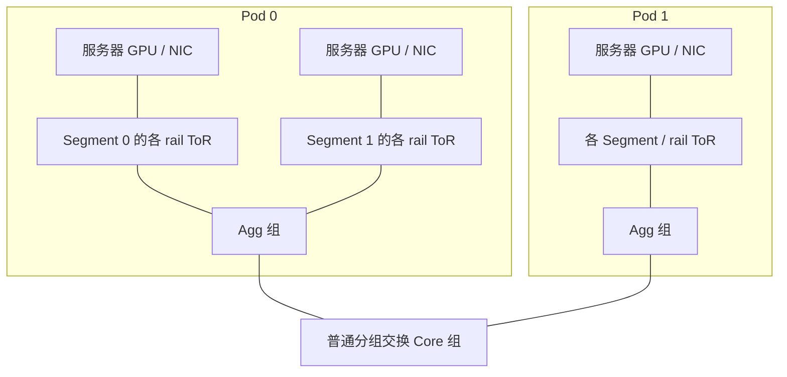

# 千卡 Clos、Agg 与多 rail / 双平面拓扑

本轮交付的是可参数化的**物理网络输入生成器**。网络核心使用普通分组交换机，输出ASTRA原生ns-3和SimAI/Alibaba的两种文本格式；不通过UB实现Scale-Out。命令、完整参数和千卡配置见[用户示例](../../examples/scaleout_topology/README.md)，实际检查结果见[证据入口](../../experiments/scaleout_topology/README.md)。

## 两张图怎样映射到代码

| 用户图片的对象 | 本版配置或对象 | 需要保留的区别 |
|---|---|---|
| 服务器与8张GPU | `deployment.gpus_per_server=8`，每GPU一个端点 | GPU类型只是分类标签；不模拟计算或HBM |
| HPN图的Segment | `segments_per_pod` | 同Pod共享上层，Segment不是独立Agg层 |
| 按GPU位置对应的ToR | `rails`及`rails_by_gpu_slot` | rail是接线分组，是否隔离取决于上层scope |
| 两个Plane | `planes=2`，每NIC分别接两个网络副本 | 交换机不跨plane连接，NIC预算必须覆盖两个端口 |
| Pod内Agg | `aggs_per_pod_per_group` | 数量按Pod/plane/group解释 |
| 跨Pod的Core | `cores_per_group` | 按plane/group解释，不乘Pod数 |
| 第二图中的OCS | `kind=core`普通分组交换机 | 没有光路配置、重构延迟或时隙调度 |

以一个plane示意，下图中的Agg/Core数量和fanout都由输入决定；多plane复制交换机网络，GPU端点共用。

两层leaf-spine通过Agg=0实现ToR→Core；ToR→Agg不带Core也支持。三层是交换层数，不包括GPU。标准三层Clos采用分组Core，类Clos可选择上层全互连或循环分配；**数量自由不意味着任意组合都满足Clos无阻塞条件**，必须检查fanout、端口、连通性和容量。

当前各Pod、Segment、plane采用同构规模，带宽按链路层统一配置。没有逐Pod异构数量、逐链路覆写或同节点对平行边。用户可以修改任意已开放参数；非法计数关系拒绝，闲置或分裂网络如实输出，不静默改线。

## HPN参考的依据与差异

来源包括用户提供的HPN Figure 7图片、第二张Pod—ToR—Agg—OCS图，以及固定版本SimAI源码。论文题名及DOI通过Crossref/OpenAlex核对为 [Alibaba HPN: A Data Center Network for Large Language Model Training](https://doi.org/10.1145/3651890.3672265)，SIGCOMM 2024；本机ACM PDF访问403，没有取得全文，故不把图片以外的论文机制写成已核实事实。

第一图显示8 rail、2 plane，以及Segment、Pod内Agg与跨PodCore的分工；每plane NIC接入200G、ToR上联400G。图中Segment还区分1024 active和64 backup GPU。本版使用相同GPU槽位的rail映射、双plane与共享Agg结构，但千卡示例缩为2 Pod×2 Segment×32服务器×8GPU，**不是照抄原图的交换机数量，也不包含备用节点、故障恢复与生产选路策略**。要研究Core，必须有跨Pod业务；同Pod最短路径通常不会经过Core。

固定SimAI提交 `a57d765c5478f319c5f5ab6fdc53f9cc7f461743` 的 [Rail_Opti_DualToR_DualPlane](https://github.com/aliyun/SimAI/blob/a57d765c5478f319c5f5ab6fdc53f9cc7f461743/astra-sim-alibabacloud/inputs/topo/gen_Topo_Template.py#L192)支持按GPU位置分rail和双plane，但模板将Pod固定为1，且会自动修正部分交换机计数。本版将Pod、各层数量和Core接线显式配置，不继承其自动修正，也不生成NVSwitch。

导出格式依据同提交的 [SimAI SetupNetwork](https://github.com/aliyun/SimAI/blob/a57d765c5478f319c5f5ab6fdc53f9cc7f461743/astra-sim-alibabacloud/astra-sim/network_frontend/ns3/common.h#L701)六字段头，以及本仓锁定ASTRA ns-3 `3964b1d41cb5f7b51004c316b0eae1a3713c2498` 的 [reader](../../third_party/LLMServingSim/astra-sim/extern/network_backend/ns-3/scratch/common.h)三字段头。两者的邻居到接口映射按节点对存储，所以拒绝平行边。文本匹配与Python独立解析已检查，原生装载和实际业务仍需另验。

## 这批配置能回答什么网络问题

| 变化维度 | 已实现的输入变化 | 后续网络实验应控制/观察 |
|---|---|---|
| 两层与三层 | 省略Agg，或加入Pod内Agg与跨PodCore | 同/跨Pod的路径、Core负载与All-to-All尾部完成时间；不能把交换机总量差异当纯层数效应 |
| 扇出与Core接线 | 全互连、分组、循环分配，上联数独立配置 | 多路径数量、拥塞位置、端口总预算与超售 |
| rail隔离与共享 | 每GPU NIC rail映射、上层按rail分组或共享 | EP rank放置、跨rail可达性、热点是否集中到同一组资源 |
| 单/双平面 | 每NIC每plane一端口，分开速率并核对NIC总预算 | 固定总带宽下的分流与故障；当前还没有实现选plane策略 |
| 各位置带宽 | GPU接入、ToR→Agg、Agg→Core或ToR→Core分别配置 | 热点形成于NIC、接入上联、Agg出口还是Core；每层队列及PFC/ECN事件需真实后端采集 |
| 扩容 | Pod/Segment/服务器/GPU、各层交换机数量 | 固定带宽预算/超售率后再比较；先16→64→256，完成资源检查后才扩到1024 |

独立rail的跨rail不可达是物理事实，不能通过允许GPU在路由BFS中转发来“修复”。本版给出一个多NIC GPU同时附着两个rail、两侧GPU仍互不可达的反例，确认审计不会把GPU当桥。

拓扑没有batch、token或专家热点字段，因为它们属于工作量。后续真实路由→通信模板→rank/GPU/NIC放置应作为独立输入，再由单一后端执行多个EP组共享网络；不能从物理图凭空生成均匀All-to-All，也不能独立跑scale-up/scale-out再相加。DP同步与EP专家交换仍由业务图分别定义。

## 规模和验证边界

这批千卡物理图都已实际静态生成，并重跑核对全部文件逐字节一致。小图独立BFS检查跨Pod六跳路径及两层四跳路径，验证每层接线、端口唯一性、分组/循环Core和GPU不能中转。相关回归共23项通过。详见[实际结果](../../experiments/scaleout_topology/results.json)。

锁定派生库每个SwitchNode的 `m_bytes[1025][1025][8]` 约32.06MiB。仅普通交换机固定数组的推算如下，**不是实测RSS，也不含路由、队列、QP和事件**：

| 配置 | 交换机 | 固定数组推算 GiB |
|---|---:|---:|
| 两层leaf-spine | 64 | 2.00 |
| 三层Clos | 320 | 10.02 |
| HPN参考双平面 | 104 | 3.26 |
| 独立multi-rail | 128 | 4.01 |

原生拓扑装载本轮未运行：检查时磁盘空闲低于既定8GiB预留，未构建、未扩大预算或清理未知数据。图与文本导出本身不能证明原生路由、RDMA回调、双plane分流或千卡业务仿真成功；原发送完成回调的缺失/重复问题仍保留，见[后端研究](scaleout_ns3_backends_20261015.md)。

下一步是小图真实装载并核对端口/速率/延迟、跨Pod单流路径、共享网络All-to-All完成语义，再在固定资源预算下验证拥塞与选路。这些步骤与本次已交付的生成能力分开验收。
