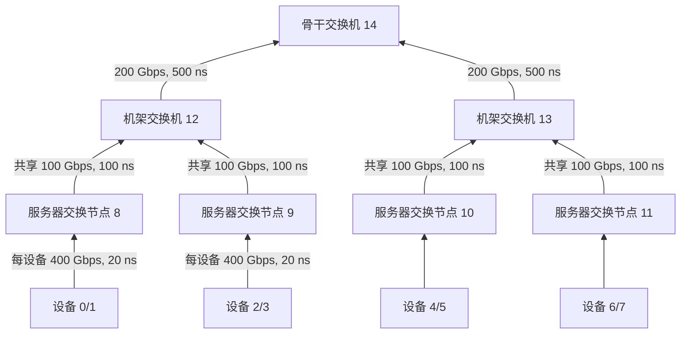

# UB 分层网络基线

此例研究设备接入、服务器共享出口与机架出口的带宽约束。准备程序生成现有联合后端的普通输入；采用单平面、单骨干的 UB 树形网络，尚未模拟 Ethernet/RoCE 协议、真实 NIC DMA 或 PCIe。

此例保留为限定假设的功能基线。服务器共享出口是本例选择，不是所有 GPU 服务器的物理事实；多 NIC / rail / Clos 的非 UB Scale-Out 方向另见[源码研究](../../docs/reviews/scaleout_ns3_backends_20261015.md)。

## 输入与路径

`prepare.json` 引用仓库内合成 MLA Decode 的完整模型服务、请求、成本与通信模板，无需模型权重或历史运行数据。形状为 2 个机架，每架 2 台服务器，每台 2 个芯片、每芯片 1 个 die。设备编号按服务器连续分配；rank 2/7/12 分别映射到设备 0/2/4，即服务器 0/1/2。设备总数 8，活跃端点 3。



图省略后两个服务器的接入速率标注，其配置同样为 400 Gbps、20 ns。每条边为对称全双工链路，每个方向独立发送；共享出口由真实交换节点/端口表示，多个设备经过同一端口时共用其序列化与队列。服务器交换节点是 UB 网络中的抽象汇聚点，不能直接当成已经实现了硬件 NIC。

## 命令

在仓库根目录、已安装 frontend 依赖的环境中：

```bash
moe-ub scaleout prepare --config examples/scaleout/prepare.json --output runs/scaleout-prepared
```

这一步无需后端，状态明确为 `prepared_not_executed`。源码检出可用 `PYTHONPATH=python python3 -m moe_ub_cosim` 代替 `moe-ub`，需要 PyYAML。完成固定依赖初始化与构建后，再执行现有流程：

```bash
moe-ub resolve --config runs/scaleout-prepared/scenario.yaml --backend build/default/output/cosim/ns3.44-cosim-service --output runs/scaleout-input
moe-ub run --config examples/scaleout/run.json --output runs/scaleout-run
moe-ub validate --run runs/scaleout-run
```

`resolve` 才会装载完整服务检查，并由指定后端校验生效参数；`run` 才执行网络。新示例实际联合执行的验收状态见[任务页](../../docs/tasks/current.md)，输入生成成功不能代替后端验证。`run.json` 限定 RSS 2 GiB、地址空间 4 GiB、产物 256 MiB、120 秒、空闲磁盘预留 8 GiB；后端超时 90 秒，仿真上限 1 ms。限额不足应检查失败原因，不能自动加大。

## 改参数与查看结果

| 字段 | 含义 |
|---|---|
| `shape` | 机架数、每架服务器数、每服务器芯片数、每芯片 die 数，均为正整数 |
| `groups` | 显式 rank 与物理设备映射；只能重放置现有逻辑成员，不能借此增加专家或请求 |
| `link_profiles.device_access` | 每设备接入链路的 `rate_bps`、`delay_ns` |
| `link_profiles.server_uplink` | 每服务器共享出口的速率与传播时延 |
| `link_profiles.rack_uplink` | 每机架共享骨干出口的速率与传播时延 |
| `node_defaults` | 节点仲裁与转发时间，单位 ns；应用于所有节点 |
| `budget` | 节点、链路、路由行及预创建连接数量上限；生成前检查 |
| `scenario` | 现有服务、层、系统、后端声明与执行参数；源路径相对配置 JSON |

所有字段必填，没有隐含覆盖参数。硬上限为 4096 节点、128 端口/节点、100 万路由行、65536 条无向连接；形状字段每项至多 128。单路径路由逐目的设备显式保存，因此路由文件随设备数约平方增长，此入口用于有界网络研究，不用于直接生成万卡数据中心。rank 全局唯一、排序，设备不重复；跨组流量在同一个网络中执行，组间无需创建业务连接。

程序复制输入并只修改层内 `rank_to_ub_node` 与 `deployment.ranks`，保留模型、专家 rank、请求、计算成本及通信模板。改变放置可能把原来的同芯片交付变成网络事务，比较前必须检查这一变化，不能当成单一带宽实验。

仅改变服务器带宽时，复制配置，修改 `link_profiles.server_uplink.rate_bps`，保持形状、映射、请求及成本不变，用新的输出目录重新 prepare、resolve、run。修改 batch 或模型，应修改引用的服务及匹配层输入，并遵守已有模型/成本/容量检查；本命令不按比例缩放历史 trace。改变拓扑后必须重新运行，不能把它塞进已有冻结首轮包冒充同一网络重放。

准备结果包括：

- `network/`：节点、链路、路由和连接四张 CSV；`scenario.yaml` 带完整链路覆盖项，确保分层带宽经过现有解析器后仍然生效。
- `ports.csv`：每个有向物理出口的邻居、所在层、方向、速率和延迟，可关联实际队列/端口观测。
- `paths.csv`：每对活跃 rank 的配置路径、0/2/4/6 跳、路径最小带宽及传播时延。同芯片为本地交付，0 表示未走网络，不能解释成 0 Gbps 的物理链路。
- `scaleout-audit.json`：放置、来源哈希、输出哈希和出口容量；`downstream_bps/uplink_bps` 表示结构超卖比。路径未计报文序列化、协议确认、排队或计算，不能当成流完成时间。

本例服务器接入总速率为 2×400 Gbps，共享上联 100 Gbps，结构超卖比 8:1；机架为 2×100/200=1:1。它们是容量约束，不是已经测得的拥塞或推理减速。

`paths.csv` 列出配置中的有向 rank 对，不代表已经发生了流量。原生 LOAD 的请求与响应方向相反，关联实际记录时应区分 initiator、data owner 与 consumer，不能只把图 SEND 的方向当作全部数据方向。

`observation.json` 只适用于本例编号，观测服务器 8/9/10 的出口 2 和机架 12/13 的出口 2。修改形状/放置后应参照新 `ports.csv` 修改观测。准备入口要求 `scenario.observation=null`，避免继承其他拓扑的端口编号；实际 `run.json` 单独选择观测。
