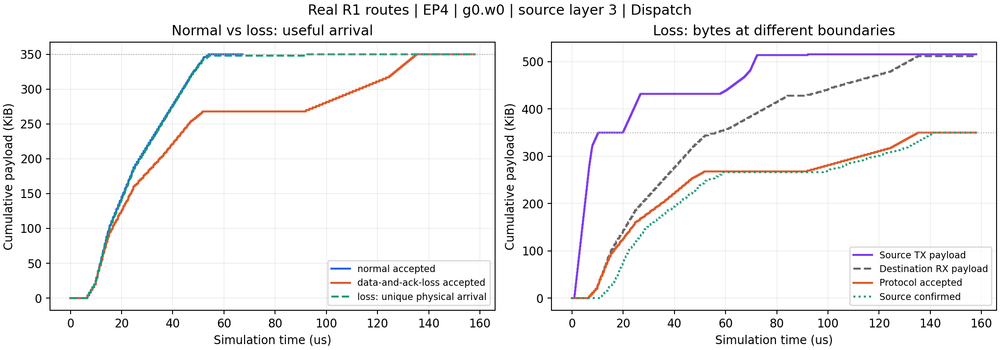
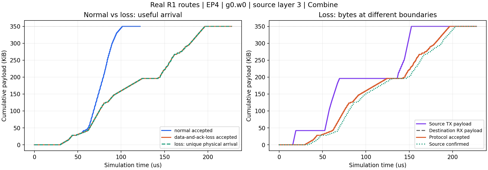

# 真实MoE路由：任务两端统计与collective有效到达

本轮已完成两次真实路由驱动的原生网络执行。四个独立请求、EP4、256专家/Top8、每rank每层64专家，执行原层3—4、Decode入口1—2。H7168、BF16激活，每专家贡献14,336B，按专家贡献复制；同token同目的rank的多专家不去重。计算为声明值，不是完整R1数值执行。

网络为4GPU/4服务器、两Pod、10交换机的三层Clos；100Gb/s接入、25Gb/s上层、每边1µs、单rail。模型GPU标签A100不提供硬件校准。真实上下文105/28/10/6token，输入context_tokens=2048是上限。多消息、多阶段共享一个网络时钟和队列。

| 全任务统计 | 正常 | 数据+ACK故障 |
|---|---:|---:|
| 逻辑消息数 | 76 | 76 |
| 逻辑有效字节 | 2,609,152 | 2,609,152 |
| 源端实际发送载荷 | 2,609,152 | 2,778,864 |
| 目的端物理接收载荷 | 2,609,152 | 2,774,864 |
| 协议有效接受字节 | 2,609,152 | 2,609,152 |
| 服务完成/µs | 333.298 | 417.998 |

故障任务多等84.700µs，约25.41%。这是两条预设丢包规则的代价，不是优化收益。

首个Dispatch切片为g0.w0、图内层0/原层3，共8消息、358,400有效字节。有效收齐由53.917µs延后至134.950µs，源端全部确认由59.996µs延后至141.029µs。故障时源端发送528,112B、目的端物理接收524,112B，有效接受仍为358,400B。多跳转发不计作新的应用字节。

数据故障为消息1（0→2、86,016B）序号2000丢两次；该消息84个乱序包、164,032B到达后被GBN丢弃，不能提前算作有效接受。消息6（2→0、71,680B）的最终累计ACK丢一次：数据47.254µs收齐，源端106.685µs才确认。这说明数据到达与发送完成须分开统计。它们是确定性单消息规则，不是全网随机丢包率。

模型与配置：现有完整形状示例Qwen3-30B为30.532B；新增声明GQA MoE为119.052B，EP8每rank每层16专家、BF16权重约32.75GiB，未运行该大模型网络。真实路由来自约671B的R1，本轮仅执行两个MoE层网络片段，不能写成完整671B模型仿真。

E256时EP2/4/8/16/64/128/256分别对应每rank每层128/64/32/16/4/2/1专家。改变EP要同步改分组和拓扑，并满足专家数整除EP。已有等容量逐层放置映射可调整专家编号归属，保持每rank数量相等；当前不支持任意不等容量分配、专家复制或动态迁移。完整GQA声明支持1—128层；真实R1服务片段支持1—4个连续MoE层。模型标签、参数声明、容量检查和已执行规模分别报告。

逐包有效曲线通过GBN接收规则从原生MacRx重放；最终前缀、完成时刻和源发包计数逐消息吻合C++记录。独立检查核对原始专家选择、两条件相同任务图、原始TX/RX、丢包命中及曲线增量，均通过。两次网络捕获51,904/53,862事件，均完整。源码、原始数据快照、命令和预算在runs/collective_arrivals_20261028-frontend；首次系统Python缺protobuf在网络启动前失败，保留于旧目录，修正使用已有frontend环境。零安装/下载/编译/GPU运行。

