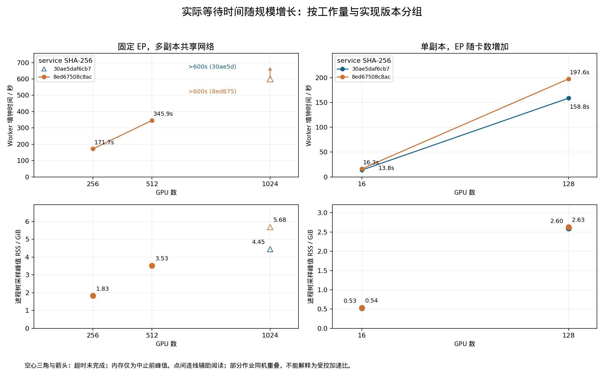

# Scale-Out 仿真实际等待时间与规模增长

本报告只读取已经结束的运行产物，没有新增仿真。Worker 时间含初始化、构图、后端执行和写出；不是纯 ns-3 CPU 时间。

| 卡数 | EP / 副本 | 实现 SHA 前缀 | Worker 秒 | 完整命令秒 | 独立校验秒 | 峰值 GiB | 仿真完成 ms | 状态 |
|---:|---|---|---:|---:|---:|---:|---:|---|
| 16 | 16 / 1 | 8ed67508c8ac | 16.30 | — | — | 0.54 | 1.846967 | 完成且独立校验通过 |
| 128 | 128 / 1 | 8ed67508c8ac | 197.62 | — | — | 2.63 | 2.121369 | 完成且独立校验通过 |
| 256 | 4 / 64 | 8ed67508c8ac | 171.66 | 181.23 | 8.28 | 1.83 | 2.198061 | 完成且独立校验通过 |
| 512 | 4 / 128 | 8ed67508c8ac | 345.93 | 365.36 | 17.01 | 3.53 | 2.189919 | 完成且独立校验通过 |
| 1024 | 4 / 256 | 8ed67508c8ac | >600 | 600.79 | — | 5.68 | — | 超过600秒未完成 |
| 16 | 16 / 1 | 30ae5daf6cb7 | 13.81 | — | — | 0.53 | 1.846967 | 完成且独立校验通过 |
| 128 | 128 / 1 | 30ae5daf6cb7 | 158.79 | — | — | 2.60 | 2.121369 | 完成且独立校验通过 |
| 1024 | 4 / 256 | 30ae5daf6cb7 | >600 | 600.89 | — | 4.45 | — | 超过600秒未完成 |

空白时间没有相应采集，不能用零补齐。命令时间与 Worker 时间之差混合准备、退出和自动校验，不能全部称为纯校验开销。

## 可比性与已知同机重叠

工作量配置：Qwen3-30B-A3B-Instruct-2507，48 层，batch/rank=1，context=2048，Decode 2 轮，GPU 标签 H100，计算来源 declared_reference，路由 synthetic，硬件校准=False。宿主时间不是 GPU 实机运行时间。

EP=N 单副本与 EP4 多副本改变了不同工作量，分别绘图。实现版本由运行时记录的 service 二进制 SHA-256 识别，不能用当前 HEAD 代替当时版本。

- baseline128 的已知重叠：baseline512：197.62s。
- baseline512 的已知重叠：baseline128：197.62s。
- numeric128 的已知重叠：numeric1024：158.79s。
- numeric1024 的已知重叠：numeric128：158.79s。

重叠只在本报告收录的 Worker 间核算；未证明其他时段宿主独占。单次样本不支持稳定分位数、严格复杂度或可靠优化加速比。

## 实际增长与使用建议

256→512 卡的本次 Worker 等待从 171.66s 增至 345.93s，观测比值 2.015。512 卡含同机重叠，不能据此认定线性复杂度。

以本次 512 卡完整命令＋独立校验 382.36s 粗算，36 个同等成本用例顺序执行约 3.82 小时；不含编译、失败重试，其他 batch/模型不能照搬。

超时只能确定未在预算内完成，无法得到完整业务模拟时间和最终内存峰值。本轮按已声明预算保留终态，不因超时继续加预算或追加优化。

优先在百卡或 256/512 卡做网络机制对照，用少量目标规模点核查趋势；先估计总用例数×单例预算，再决定是否展开矩阵。保持模型、EP、副本、层数、batch、拓扑和实现版本可追踪。

## 复核入口

timings.csv / timings.json 保存全部时钟、预算、状态、规模及已知重叠。evidence.json 保存公开小文件的内容、原路径与 SHA-256，可在原始 tmpfs 不存在时重绘；原始完整结果另行归档。

宿主 CPU：Intel(R) Xeon(R) Platinum 8336C CPU @ 2.30GHz；系统内存 64.0 GiB。硬件与可用 CPU 为分析时快照，无历史独占负载记录。
