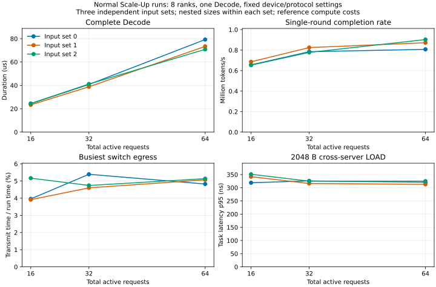

# 首批正常小场景结果

2026-10-08 完成九组正常运行：8 个 rank（计算进程）、两台服务器、两个网络平面、4 个 Transformer 块；每 rank 2、4、8 个请求，各配三组预先固定的合成请求与专家选择。每组执行一次完整 Decode，即所有请求各生成一个 Token。配置及生成规则见[输入说明](configs/README.md)，统计含义见[概览口径](overview-method.md)。计算成本是参考值，本结果不代表真实设备或连续服务的吞吐。

首批发现了值得继续解释的完成时间差异，但没有发现持续的交换出口停发，也没有看到同大小 LOAD 任务随批次扩大而一致恶化的尾延迟。下一步优先检查端侧发送等待，暂不据此增加复杂模型或执行完整场景。

## 九组比较

下表的时间来自实际服务完成事件。速率是本轮 Token 数除以整轮时间；同一输入组的三个规模采用嵌套请求集合，九组不是九次独立随机重复。

| 每 rank 请求数 | 总请求数 | 输入组 0：µs | 输入组 1：µs | 输入组 2：µs | 单轮完成速率范围：百万 Token/s |
|---:|---:|---:|---:|---:|---:|
| 2 | 16 | 24.374 | 23.324 | 24.488 | 0.653–0.686 |
| 4 | 32 | 40.790 | 38.792 | 41.150 | 0.778–0.825 |
| 8 | 64 | 79.249 | 73.393 | 70.865 | 0.808–0.903 |

图中 p95 是第 95 百分位数。可复核的数值、输入和结果摘要、程序与后端摘要及资源记录索引保存在 [results-normal-v1.json](results-normal-v1.json)。图可由[公开绘图命令](usage.md)重新生成。

## 现象与解释状态

| 发生条件与证据 | 性能影响 | 当前解释与边界 |
|---|---|---|
| 三组输入都从 16 增至 64 请求，同时重新生成计算和通信工作量 | 整轮更长，单轮完成速率也更高 | 不能把总时间增长本身当作异常或拥塞证据 |
| `s0-b8` 与 `s2-b8` 总计算工作量均为 313,636 rank·ns，跨芯片搬运任务分别为 1496、1480 | 整轮相差 8.384 µs，前者比后者长约 11.8% | 总计算工作量不足以解释差异。逐 rank 工作分布、通信和依赖顺序需要继续核验，尚未确定主因 |
| 九组最忙交换出口的整轮发送占用率为 3.914%–5.391%；详细队列减去实际发送区间后，非空却未发送的连续区间最长均为 1 ns | 未见长时间交换出口停发 | 1 ns 间隙本身不能判为反压。平均占用低也不能证明所有瞬时争用或端侧限制都不存在 |
| SEND 节点的显式前驱全部完成后，距实际开始的最长间隔，各组为 1.521–8.904 µs；其中 `s0-b8` 为 8.904 µs | 端侧尚未开始发送的间隔比单个搬运任务的典型网络时间长，可能影响推进 | 这是从依赖图推导的间隔，不是直接记录的发送槽或信用等待；各节点间隔会重叠，不能相加作为整轮损失 |
| 同为跨服务器、2048 B 的 Combine LOAD 数据任务：九组中位数均为 294 ns，p95 为 313–351 ns | 没有呈现随请求数增大而一致加重的任务尾延迟 | 目前不足以选择“严重 LOAD 拖尾”作为首个深入案例；少量输入组也不足以推断统计规律 |
| 跨服务器 STORE 数据任务在数据就绪后，至协议完成的尾段中位数为 88 ns；LOAD 对应值为 0 ns | STORE 的数据可用与发起资源释放发生在不同时刻 | 两种操作的完成语义不同，不能将这一差值直接标成异常；现有记录尚未包含逐原生请求的完整时序 |

这里的 rank·ns 是各 rank 计算节点持续时间之和，并非整轮墙钟时间。发送占用按真实物理发送区间计算，分母为实际仿真时长；没有使用观测配置尾部的空白时间稀释结果。

当前原生请求参数为 STORE 请求 512 B、LOAD 响应 512 B、LOAD 请求 64 B。1068 B STORE 数据任务实际包含 3 个有效分段，2048 B LOAD 包含 4 个；不能根据其他传输参数推断它们未发生原生拆分。分段数来自实际提交计数，不能替代逐请求起止事件。

## 下一步选择依据

建议先做少量发送槽对照：保留全部三个输入组的每 rank 8 请求输入、拓扑、计算成本、原生在途上限、观测配置等条件，将每 rank 发送槽从 1 改为 2。同时沿现有节点、传输和依赖记录追踪最长的几个开始前间隔，比较整轮时间、等待变化与队列变化。该对照尚未执行，执行前需固定范围与判断口径。

如果间隔缩短但整轮不改善，继续检查它是否处于完成的关键依赖链；如果改善同时增加网络积压，也保留这一取舍。只有现有事件无法区分具体等待对象时，再明确需要补充的调度、在途资源或信用状态记录，并作为独立平台任务实施。当前结果尚不能支持扩大为全参数扫描、补接收端内存服务模型或直接运行完整场景。

## 查看与复现

入口见[运行与查看](usage.md)。本轮本地产物根目录为 `runs/scaleup_observability/normal-v1/`：

| 文件或目录 | 用途 |
|---|---|
| `batch.json`、`inputs/<case>/` | 执行前冻结的九组配置、请求、逐专家输入量及摘要 |
| `report.json` | 九组统一汇总，以及后端、平台来源与分析版本一致性检查 |
| `runs/<case>/overview/summary.json` | 本组完整结束、工作量、三个层次的概览与 CSV 摘要 |
| `runs/<case>/overview/ports.csv`、`queued-without-transmission.csv` | 全部 32 出口的发送与队列，以及非空却未发送区间 |
| `runs/<case>/overview/transfers.csv`、`transfer-groups.csv` | 每个搬运任务与同口径任务组的完成和尾段 |
| `runs/<case>/overview/nodes.csv`、`ranks.csv`、`layers.csv`、`progress.csv` | 节点起止、依赖推导间隔、工作分布和完成进度 |
| `runs/<case>/run/`、`commands/` | 平台清单、实际观测与内部记录，以及各阶段命令、日志和资源记录 |
| `figures-v2/` | 本页图的 SVG、PNG、绘图数据和命令；`figures/` 保留早先布局，数值相同 |

这些完整概览用于研究者核验，可以读取内部资料；后续被动测量算法不能直接把它们当作默认观测输入。运行日志集中在上述目录及 `runs/scaleup_observability/checks/`，不追加到方案原文。

## 完成核验与资源

13 项实验输入、隔离、统计与异常输入检查通过。九组实际联合执行、导出、公开校验及概览全部成功：每个请求各完成一个 Token，逐层路由消费完整，网络排空；计划与实际搬运一一对应；32 个出口的详细计数、队列积分和峰值与公开聚合记录一致；实际计算时长与本次图成本一致。另核对冻结的逐专家贡献与执行计划的逐 rank 汇总相等，以及图表数值和来源摘要一致。

本次沿用同一已验收后端及平台源码，没有重新构建或修改依赖。实际仿真通过与参考成本的硬件准确性分别对待；本批未进行硬件校准。

封存核验时，登记产物累计约 37.592 GiB，较首批预检新增约 116.5 MiB，低于包含旧产物的 48 GiB 上限；后续少量交付日志不包含在该快照内。没有删除旧产物、下载数据或提高额度。每阶段沿用 RSS（驻留内存）8 GiB、地址空间 12 GiB、1800 秒上限，未触发资源停止。

九组共 45 个主要受监测阶段，包括解析、执行、导出、校验、概览，各阶段墙钟约 30.35–31.97 秒，合计约 23.2 分钟；含逐组预检的运行命令累计约 24.9 分钟。这主要包含对旧产物目录的累计磁盘扫描，不能解释成 ns-3 计算耗时。监测采样可能漏过很短的子进程内存峰值；记录中的最大单个已等待子进程高水位约 103.2 MiB，不能视为整个进程组峰值。逐阶段原始值及此限制保存在数值摘要中。
