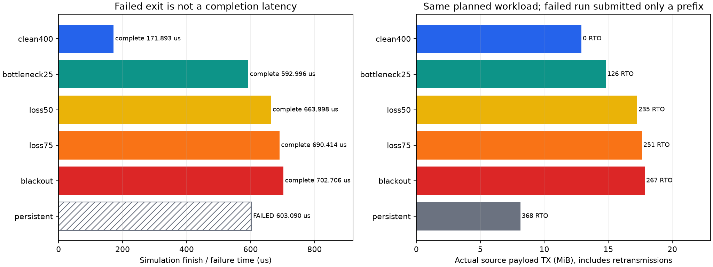
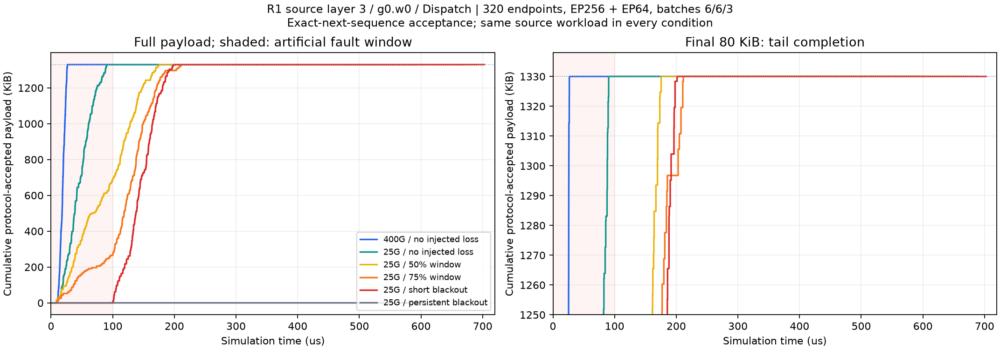
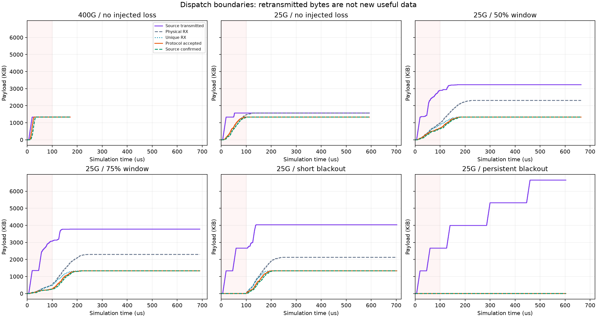

真实MoE路由的跨机网络严重丢包实验
===================================

本轮以实际SimAI/Vidur调度与单个原生ns-3网络为新基线，研究并发通信在带宽瓶颈、
短时大量丢包和持续黑洞下如何等待、恢复或失败。网络后端使用ASTRA配套的原生RDMA，
与此前UB入口独立。新增的是任务接入、联合推进、故障和观测能力；没有把成熟重传称为新算法。

.. raw:: html

   
<a href="_static/severe-loss-20261028/report.html">打开完整离线交互报告：六条件、逐轮硬件摘要、累计有效到达和逐包下载</a>

实验条件与约束
--------------

* 模拟H100容量参考，320个GPU端点、40服务器、5Pod，每服务器8个GPU。
* Clos结构：20个ToR、20个Agg、8个Core，440条边；接入400Gb/s，上层400或25Gb/s。
* EP256与EP64两组，每rank每层分别1与4个专家；两组共享同一个网络和时钟。
* 15份不同的真实R1-AWQ/mmlu专家选择；rank0、128、256的实际batch分别6、6、3。
* R1尺寸E256/Top8/H7168，2字节激活；只执行原层3、4的两步Decode，初始KV就绪。
* 完成条件790条消息、13,533,184有效字节，218个端点实际发送或接收；320端点不等于满载。

来源目录经用户确认，原件哈希已校验；远端下载revision未知。计算耗时为声明参考，
没有完整R1数值执行、真GPU运行或硬件时延校准。六条件各执行一次，不声称生产SLA或统计置信区间。

结果与收益空间
--------------

.. list-table:: 网络终态时间；失败时间不是完成时延
   :header-rows: 1
   :widths: 28 18 20 34

   * - 条件
     - 终态时间µs
     - 结果
     - 实际窗口丢包 / 全观察期丢包
   * - 400G，无人工丢包
     - 171.893
     - 完成
     - 无人工注入
   * - 25G，无人工丢包
     - 592.996
     - 完成
     - 无人工注入
   * - 25G，50%短窗
     - 663.998
     - 完成
     - 219/438；219/2517
   * - 25G，75%短窗
     - 690.414
     - 完成
     - 308/410；308/2562
   * - 25G，短时全丢
     - 702.706
     - 完成
     - 357/357；357/2586
   * - 25G，持续全丢
     - 603.090
     - 重试耗尽失败
     - 1170/1170；1170/1170

丢包短窗为[0,100µs)，周期性作用于实际目标数据包，包括重传；ACK/NACK/PFC不丢。
50%或75%是窗口内规则，有限尾周期使实际75%条件为308/410；不是整段任务75%独立随机丢包。
人工注入不能冒充拥塞自然产生的丢包。

固定工作量时，上层400G降至25G增加421.103µs。相对25G无人工丢包，50%、75%、短全丢
分别增加71.002、97.418、109.710µs，约12.0%、16.4%、18.5%。
这些是已观察到的故障代价，还不是一种优化可实现的收益；可消除比例需要较强基线对照。

累计有效到达与逐包边界
----------------------

固定切片g0.w0、原层3、EP256的Dispatch或Combine，各有1,361,920目标有效字节。
物理到达、去重字节、协议连续接受、源端确认分别记录；重传与乱序丢弃不能重复增加有效进度。
持续黑洞的有效接受始终为0，且没有执行到Combine，不生成虚构的Combine曲线。

两组EP首轮都在0ns提交，实际同时未确认消息最多92至142条；后续轮次由真实完成回调推进。
持续黑洞只提交92条消息、1,705,984字节，后续任务未执行，不能以较小工作量比较吞吐。

一个明确的后续优化问题
----------------------

25G无人工丢包仍触发126次RTO，重复发送2,008,392字节，400G条件为0。
其中86次超时时，能推进确认的ACK已经在返程途中。消息109的ACK于44.535µs发出，
源49.619µs超时，50.597µs收到ACK。这来自同一次运行的包和定时器记录。

下一步应固定流量与网络，对比更适合反馈延迟的RTO设置，测重复字节、正常任务干扰与阶段时延。
已有ACK在途不证明后续所有字节都无缺失；这些超时区间不能直接相加为可消除收益。

后端原有机制与项目扩展
----------------------

* 原生：ECN标记、DCQCN速率反馈、PFC暂停/恢复、累计ACK与NACK。
* 原生恢复：缺口后的乱序包不缓存，源回退到未确认前缀，属于Go-Back-N风格，未启用选择性重传。
* 项目适配：源端RTO与退避、重复数据补ACK、有限无进展重试及失败报告。
* 项目观测：逐轮硬件/EP/batch摘要、周期性人工故障、逐包审核与有效到达曲线。

模拟的是RoCE风格机制，不是完整商用协议栈或NIC固件。自然MMU溢出的被动观测仍有盲区，
人工注入计数不能替代全部自然丢包计数。

代码、数据与验收
----------------

研究仓库基线 ``0f53b15``，平台扩展 ``0d1939e``，研究结果 ``88b6d03``。
文档仓库提供完整报告、证据与本轮增量补丁，复现需要原研究仓库、固定依赖及对应15份原件。

* :download:`复现步骤与目录说明 <../research/simai_severe_loss/README.md>`
* :download:`预登记方法与预算 <../research/simai_severe_loss/protocol.md>`
* :download:`平台扩展增量补丁 <../research/simai_severe_loss/platform.patch>`
* :download:`实验执行脚本 <../research/simai_severe_loss/run.py>`
* :download:`独立评价脚本 <../research/simai_severe_loss/verify.py>`
* :download:`绘图与离线网页生成 <../research/simai_severe_loss/render.py>`
* :download:`网页与归档核验 <../research/simai_severe_loss/audit_report.py>`
* :download:`原生RDMA机制说明 <../research/simai_severe_loss/rdma_congestion_loss.md>`
* :download:`资源、命令与修正记录 <../research/simai_severe_loss/closeout.json>`

独立核426,742个包事件与8,259行曲线；归档核118,138行切片包明细和112个文件哈希。
网页六个条件的切换通过V8与DOM替身检查，未冒称完成浏览器布局自动化。
全部网络条件各一次、未扩限重跑。详细证据由完整离线报告统一提供。
